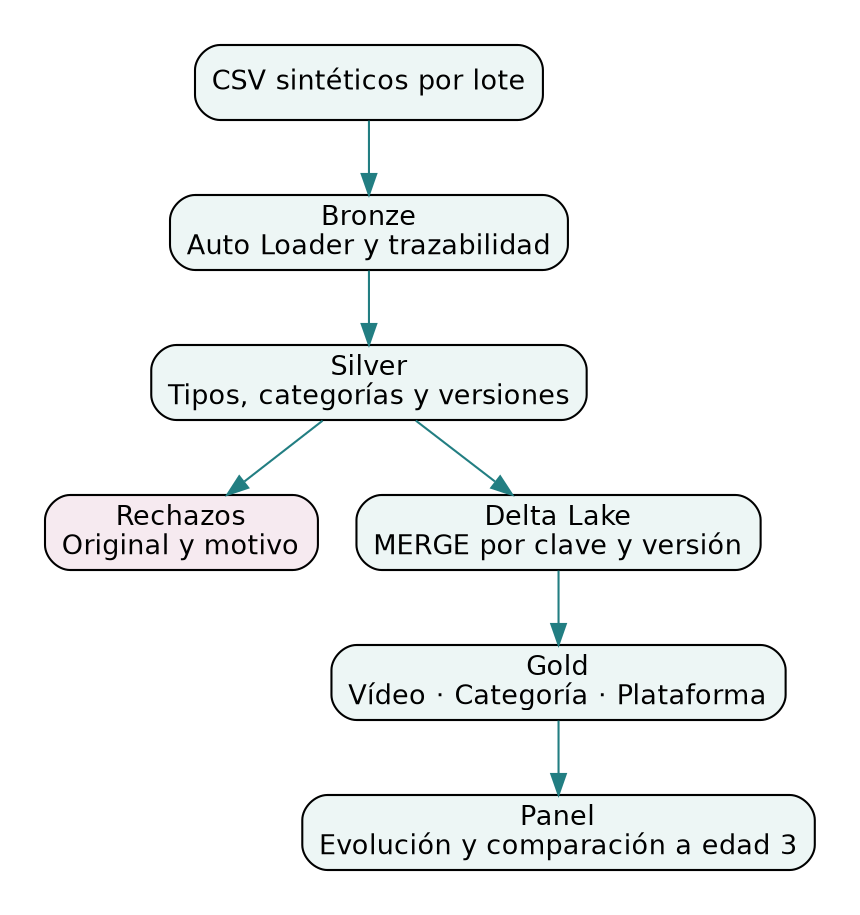
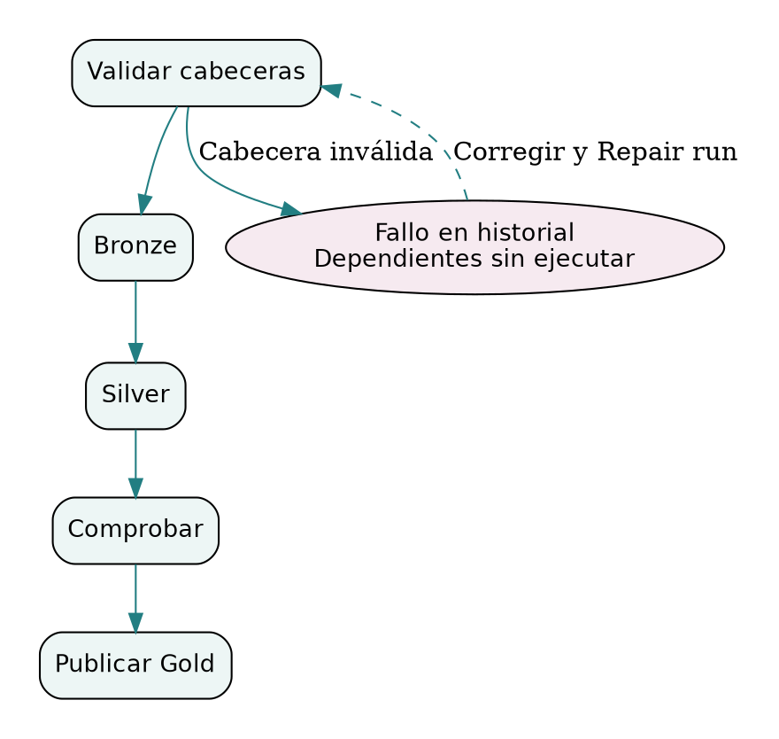

# DirectData

Análisis del rendimiento de vídeos de una tienda de variedades en TikTok e Instagram.
La solución procesa CSV sintéticos, conserva mediciones diarias en Delta Lake y compara regalos, comida asiática, belleza y juguetes.

## Qué responde

- Cómo evolucionan las reproducciones de un vídeo.
- Qué categorías tienen más interacción al tercer día de publicación dentro de cada plataforma.
- Cuántos vídeos y reproducciones acumula cada plataforma en su última medición disponible.

## Arquitectura



Publicaciones y mediciones llegan a Bronze como texto con archivo, lote y fecha de ingesta. Silver normaliza categorías, convierte tipos y registra rechazos. Las mediciones se consolidan con MERGE por plataforma, vídeo y fecha. Gold publica tres tablas Delta.



El job ejecuta cinco tareas en orden. Una cabecera incorrecta provoca un fallo antes de ingerir. Una vez corregida la entrada, Repair run permite reanudar la ejecución. Cada job admite una ejecución activa para evitar escritores concurrentes.

## Tecnologías

Python, PySpark, Delta Lake, Databricks Free Edition, Auto Loader, Unity Catalog, Lakeflow Jobs, SQL, pytest y GitHub Actions.

## Arranque local

Python 3.11 y Java 17 son el entorno de referencia para las pruebas. Desde la raíz del repositorio:

```powershell
py -3.11 -m venv .venv
.\.venv\Scripts\Activate.ps1
python -m pip install -r requirements-dev.txt
python scripts/generar_datos.py
python -m pytest -q
```

La primera ejecución de Spark descarga los JAR de Delta desde Maven. El generador por sí solo usa la biblioteca estándar. Escribe rutas relativas al repositorio y siempre reproduce la misma muestra con semilla 750.

## Despliegue en Databricks

Seguir [la guía de despliegue](docs/despliegue.md). Importar este repositorio como Git folder permite que los notebooks utilicen el paquete de src. La cuenta que ejecuta el job necesita permisos para crear esquemas y un volumen en el catálogo elegido, además de leer y escribir sus tablas.

En Databricks, PySpark y Delta están incluidos en el runtime. La instalación de requirements-dev.txt corresponde al entorno local de pruebas.

## Datos y reglas

40 publicaciones, 20 por plataforma, cinco de cada categoría en cada plataforma. Las publicaciones tienen entre cero y dos días de edad al comenzar las mediciones. El control TikTok/V000 solo tiene dos mediciones.

| Lote | Contenido |
|---|---|
| lote_01 | Día 1, 40 mediciones |
| lote_02 | Día 2, 40 mediciones |
| lote_03 | Días 3–12, 390 mediciones válidas y un vídeo desconocido |
| lote_correccion | Día 1 del control, versión 2, 950 reproducciones |
| lote_reenvio | Archivo nuevo con versión 1 del control, 1.000 reproducciones |
| lote_calidad | Siete filas con cinco entradas inválidas y dos copias del control |
| lote_fallo | Cabecera incompleta para probar el fallo y reparación |

La clave de las mediciones es (plataforma, video_id, fecha_medicion). La versión es un entero. El MERGE acepta versiones mayores, conserva la versión vigente al recibir una antigua y falla si una misma clave y versión tiene métricas contradictorias.

La tasa de interacción es 100 × suma de interacciones / suma de reproducciones. Con denominador cero devuelve NULL. Una disminución del contador acumulado se conserva y se señala en descenso_acumulado. La tabla por categoría usa edad_dias = 3 y muestra su cobertura. El control queda fuera de ese corte, por lo que el total comparable es 39.

## Demostración y validación

El [guion de demostración](docs/demo.md) incluye cargas, repetición, corrección, reenvío y reparación. Las pruebas automatizadas ejecutan las transformaciones compartidas y un MERGE real sobre Delta local.

El despliegue y las evidencias de Auto Loader, serverless y Repair run requieren ejecutar el proyecto en un workspace. El informe técnico distingue esta verificación de las pruebas locales.

## Entregables

- Notebooks exportados y código reutilizable en src/directdata.
- Datos de ejemplo y generador.
- JSON de job generado con la ruta del workspace.
- Guía de despliegue, panel y demostración.
- Informe técnico PDF y presentación en docs.
- Diagramas y pruebas automatizadas.

## Decisiones y limitaciones

Silver reconcilia Bronze completo en cada ejecución para simplificar la recuperación con esta muestra pequeña. Los rechazos conservan el JSON original y se deduplican por contenido y motivo. El log registra filas totales leídas de Bronze, rechazos únicos y cambios efectivos de MERGE, por intento de ejecución.

Cada tabla Gold se reemplaza de forma atómica individualmente. Tras una ejecución fallida de publicación, reparar Gold reconstruye las tres tablas. Consultar el panel cuando el job haya terminado correctamente.

Los permisos se limitan a los disponibles en el workspace. La configuración usa un catálogo existente. El trabajo futuro puede incorporar ingesta de plataformas reales, procesamiento por cambios y publicación coordinada entre tablas.

## Referencias

- [Auto Loader y AvailableNow](https://docs.databricks.com/aws/en/ingestion/cloud-object-storage/auto-loader/production)
- [Jobs serverless](https://docs.databricks.com/aws/en/jobs/run-serverless-jobs)
- [Límites de Free Edition](https://docs.databricks.com/aws/en/getting-started/free-edition-limitations)
